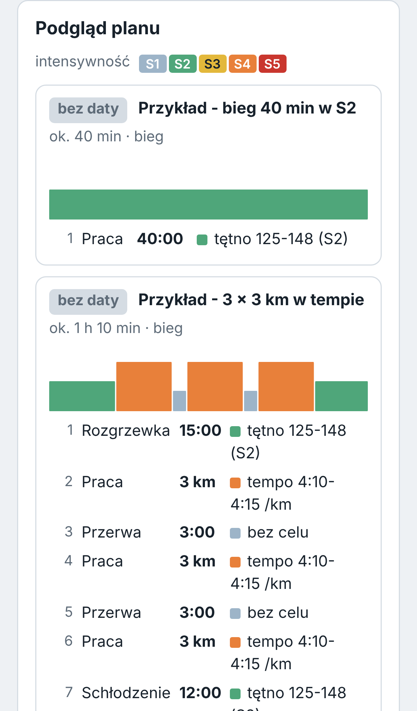

# Garmin Plan Loader

Strona do wgrywania **planu treningowego od trenera** do **Garmin Connect** – razem z datami w kalendarzu, tak żeby treningi same pojawiły się na zegarku po synchronizacji.

Działa w przeglądarce: **na komputerze i na telefonie**, bez instalowania czegokolwiek. Na telefonie można ją dodać do ekranu głównego („Dodaj do ekranu początkowego”) – otwiera się wtedy jak zwykła aplikacja.

> ⚠️ **Program nieoficjalny.** Nie jest związany z firmą Garmin ani przez nią wspierany. Korzysta z nieoficjalnej biblioteki [python-garminconnect](https://github.com/cyberjunky/python-garminconnect), która może przestać działać po zmianach po stronie Garmina. Używasz na własną odpowiedzialność, zgodnie z regulaminem Garmin Connect.

<p> </p>

## Jak używać

1. **Otwórz stronę** (adres serwera, na którym działa – patrz „Uruchomienie na serwerze”).
2. **Zaloguj się** e-mailem i hasłem do Garmin Connect. Jeśli masz włączone MFA, strona poprosi o kod z e-maila/SMS/aplikacji.
3. **Ustaw raz swoje strefy** (przycisk „Moje strefy i FTP”): strefy tętna dla biegu, roweru i pływania, FTP oraz strefy mocy roweru w watach (można je policzyć z FTP jednym przyciskiem). Zostają zapisane w tej przeglądarce i są używane przy każdym kolejnym planie.
4. **Skopiuj prompt** przyciskiem „Skopiuj prompt dla AI” i wklej go do swojego asystenta AI (ChatGPT, Claude, Gemini…) razem z planem od trenera. Na telefonie możesz też użyć „Wyślij prompt do aplikacji AI”, który otwiera systemowe menu udostępniania. Prompt już zna Twoje strefy, więc AI o nie nie pyta. AI zwróci plan w formacie JSON.
5. **Wklej JSON** w pole planu (albo wczytaj plik). Podgląd pojawia się sam: każdy trening jako karta z wykresem intensywności i listą kroków – **sprawdź go, zanim wyślesz**.
6. **Wyślij.** Treningi trafią do Garmin Connect (Trening → Treningi) i do kalendarza. Zsynchronizuj zegarek.

Przycisk „Przykład” wstawia gotowy przykładowy plan, żeby zobaczyć, jak to działa.

Kolejny tydzień? Wklej nowy plan i wyślij – treningi o tej samej nazwie nie są dublowane, a jeśli zmieniła się data, wpis w kalendarzu jest przestawiany. Zaznacz „Nadpisz”, gdy zmieniły się same kroki.

Strefy i zapamiętane logowanie są zapisane **osobno na każdym urządzeniu** (w przeglądarce). Na telefonie i na komputerze ustawiasz je raz, na każdym z osobna.

## Format planu

```json
{
  "strefy": {
    "bieg": { "S1": [80, 124], "S2": [125, 148], "S3": [149, 170], "S4": [171, 182], "S5": [183, 196] }
  },
  "treningi": [
    {
      "nazwa": "3 x 3 km @ 4:10-4:15",
      "sport": "bieg",
      "data": "2026-10-06",
      "kroki": [
        { "typ": "rozgrzewka", "czas": "15:00", "cel": "S2" },
        { "powtorz": 3, "kroki": [
            { "typ": "interwal", "dystans": "3 km", "cel": "4:10-4:15" },
            { "typ": "przerwa",  "czas": "3:00",    "cel": "S1" }
        ]},
        { "typ": "schlodzenie", "czas": "10:00", "cel": "S1" }
      ]
    },
    { "data": "2026-10-07", "wolne": true }
  ]
}
```

- **Cel kroku:** strefa (`S1`–`S5`, wg Twojej tabeli), zakres tętna (`HR 150-160`), tempo (`4:10-4:15`), dla roweru moc (`200-220W`) albo brak celu.
- Krok ma **czas** albo **dystans** albo `"przycisk": true` (trwa do naciśnięcia przycisku okrążenia), nigdy kilka naraz.
- Tempo: min/km dla biegu, marszu i turystyki (`4:10-4:15`), min/100 m dla pływania (`1:50-2:00`). Kadencja: `90-100rpm`.
- **Rower, moc:** `"cel"` może być w watach (`200-220W`), w procentach FTP (`90-95% FTP`, program przeliczy na waty z Twojego FTP; pojedyncza wartość, np. `95% FTP`, daje pasmo +/-2 punkty procentowe) albo strefą mocy `P1`-`P5` z Twojej tabeli. `S1`-`S5` to zawsze strefy tętna. FTP można też podać w samym planie (`"ftp": 220`).

## Rodzaje treningów

`"sport"` może mieć wartość: `bieg`, `rower`, `plywanie`, `silowy`, `cardio`, `joga`, `pilates`, `hiit`, `mobilnosc`, `marsz`, `turystyka`, `inny` (polskie i angielskie nazwy są rozpoznawane). Wielosportu (kilka dyscyplin w jednym treningu) program nie obsługuje - rozbij go na osobne treningi. Sporty bez własnej tabeli stref (siła, cardio, marsz itd.) używają tętna z tabeli biegowej; rower i pływanie mają własne.

### Trening siłowy

Kroki to ćwiczenia z katalogu Garmin Connect (ok. 1500 pozycji):

```json
{
  "nazwa": "Siła A",
  "sport": "silowy",
  "kroki": [
    { "typ": "rozgrzewka", "czas": "8:00" },
    { "cwiczenie": "Barbell Back Squat", "serie": 4, "powtorzenia": 6, "ciezar": "70kg", "przerwa": "2:00" },
    { "cwiczenie": "Plank", "serie": 3, "czas": "0:45", "przerwa": "1:00" },
    { "powtorz": 3, "kroki": [
      { "cwiczenie": "Pull-up", "powtorzenia": 6 },
      { "cwiczenie": "Dumbbell Row", "powtorzenia": 10, "ciezar": 20 }
    ] }
  ]
}
```

- Nazwę ćwiczenia podaj po angielsku jak w Garmin Connect (np. `Romanian Deadlift`); program rozpoznaje też popularne polskie nazwy (`przysiad ze sztangą`, `martwy ciąg`, `podciąganie`).
- Gdy ćwiczenia nie ma w katalogu, dodaj `"kategoria"` (np. `"kategoria": "LEG_CURL"`) - Garmin pokaże wtedy samą kategorię, a nazwa z planu trafi do opisu w podglądzie.
- `powtorz` robi serie łączone (obwód): kolejne ćwiczenia w rundach.
- `ciezar` jest w kilogramach i opcjonalny, `przerwa` to odpoczynek po każdej serii (także po ostatniej, jak w edytorze Garmina).

> **Uwaga:** format ćwiczeń siłowych jest zgodny z tym, co buduje biblioteka python-garminconnect. Pozostałe typy (pływanie, joga, HIIT itd.) używają zwykłych kroków i nie zostały jeszcze sprawdzone na prawdziwym koncie Garmin - jeśli Garmin coś odrzuci, strona pokaże jego komunikat w logu wysyłki.

- Sekcja `strefy` w planie jest **opcjonalna**: bez niej program użyje stref zapisanych w „Moje strefy i FTP”. Jeśli plan ją zawiera, ma pierwszeństwo.
- Prawidłowy prompt do swojego AI dostajesz przyciskiem na stronie – nie musisz pisać formatu ręcznie.

## Claude w czacie (connector MCP)

Plan Loader działa też jako **connector dla Claude** (claude.ai w przeglądarce, aplikacja na telefon
i desktop). Wtedy w zwykłej rozmowie Claude sam:

- **układa i wysyła plany** na zegarek: sprawdza plan, pokazuje Ci podgląd, a po Twojej akceptacji
  wysyła go do Garmin Connect razem z kalendarzem (bez dublowania, jak na stronie),
- **czyta Twoje dane**: wykonane aktywności (z okrążeniami i czasem w strefach), sen, HRV, tętno
  spoczynkowe, Body Battery, stres, Training Readiness, Training Status (obciążenie, ACWR), VO2max,
- **zagląda do kalendarza** i zdejmuje z niego treningi.

| Narzędzie | Parametry | Co zwraca |
|---|---|---|
| `format_planu` | - | format JSON planu + Twoje strefy |
| `moje_ustawienia` | `z_garmina` | strefy tętna/mocy i FTP (zapisane tutaj i z profilu Garmin) |
| `sprawdz_plan` | `plan` | podgląd planu bez wysyłania |
| `wyslij_plan` | `plan`, `nadpisz` | wysyłka do Garmin Connect + kalendarz |
| `kalendarz` | `od`, `do` (do 3 mies.) | zaplanowane treningi: data, nazwa, `workout_id`, `wpis_id` |
| `usun_z_kalendarza` | `wpis_id` | zdejmuje trening z kalendarza |
| `plan_treningu` | `workout_id`, `surowe` | kroki zaplanowanego treningu: bloki powtórzeń, ćwiczenie, powtórzenia, `ciezar_kg`, `czas_s`/`dystans_m`, cel |
| `aktywnosci` | `od`, `do` (do 92 dni), `sport` | wykonane treningi: czas, dystans, HR, moc, NP, TSS, TE, obciążenie |
| `trening` | `activity_id`, `surowe` | szczegóły aktywności: podsumowanie, okrążenia, czas w strefach HR |
| `serie` | `activity_id` | serie siłowe (ćwiczenie, powtórzenia, `ciezar_kg`, `czas_s`, `krok_planu`) + podsumowanie per ćwiczenie i tonaż |
| `plan_vs_wykonanie` | `activity_id` | plan z kalendarza vs wykonanie: siła per krok (serie, powtórzenia, ciężar), wytrzymałość per okrążenie (czas, dystans, HR, moc, tempo vs cel), flaga `odchylenie` |
| `pobierz_fit` | `activity_id` albo `od`, `do`, `sport` (do 20), `cel` (`dysk`/`link`) | oryginalne pliki FIT: na Dysk Google (gdy połączony) albo linki ważne 1 h |
| `polacz_dysk_google` | - | link do jednorazowego połączenia Dysku Google i stan połączenia |
| `stan_dysku` | `od`, `do` (do 92 dni), `sport`, `uzupelnij` | pliki FIT na Dysku: duplikaty, pliki bez numeru, brakujące aktywności, dogranie braków |
| `wellness` | `od`, `do` (do 14 dni) | sen, HRV, tętno spoczynkowe, Body Battery, stres |
| `gotowosc` | `data` | Training Readiness, Training Status, ACWR, VO2max |
| `surowe_dane` | `zrodlo`, `id` | diagnostyka: surowa odpowiedź Garmina (do ~30 kB) |

Konwencje odpowiedzi: polskie klucze bez ogonków, daty RRRR-MM-DD, jednostki w nazwach pól
(`ciezar_kg`, `czas_s`, `dystans_m`, `tempo_min_km`, `moc_w`); w nowych narzędziach brak danych = `null`.
Każda odpowiedź jest przycinana do 60 000 znaków.

Przykład `serie` (skrócony, Siłownia A z 22.11.2026):

```json
{"activity_id": 25162650914,
 "podsumowanie": {"serie_aktywne": 31, "powtorzenia": 362, "tonaz_kg": 5534.0},
 "cwiczenia": [{"cwiczenie": "PULL_UP / LAT_PULLDOWN", "serie": 4, "powtorzenia": 40,
                "tonaz_kg": 1800.0, "ciezar_max_kg": 45.0, "ciezar_sr_kg": 45.0}, "..."],
 "serie": [{"nr": 1, "typ": "aktywna", "cwiczenie": "PULL_UP / LAT_PULLDOWN", "powtorzenia": 10,
            "ciezar_kg": 45.0, "czas_s": 76, "start_utc": "2026-11-22T11:31:11.0", "krok_planu": 0}, "..."]}
```

Przykład `plan_vs_wykonanie` (jeden wiersz):

```json
{"nr_kroku": 2, "cwiczenie_plan": "PULL_UP / LAT_PULLDOWN", "serie_plan": 4, "serie_wykonane": 4,
 "powtorzenia_plan_seria": 10, "powtorzenia_wykonane": [10, 10, 10, 10],
 "ciezar_plan_kg": 42.5, "ciezar_wykonany_kg": [45.0, 45.0, 45.0, 45.0], "odchylenie": ["ciężar"]}
```

Odchylenie: liczba serii różna od planu, powtórzenia albo czas różne o ≥10%, ciężar o ≥5%, dystans o ≥5%,
średnie HR/moc poza celem podanym liczbami (cele strefowe nie są oceniane). Serie siłowe są łączone z
krokami planu przez `wktStepIndex` (konektor sprawdza dwie konwencje numeracji i wybiera tę, w której
zgadzają się kategorie ćwiczeń); w wytrzymałości kroki planu są łączone z okrążeniami po kolejności.
Aktywność bez `associatedWorkoutId` dostaje komunikat zamiast błędu.

**Pliki FIT**: serwer działa zdalnie (Render), więc nie zapisuje plików na Twój dysk lokalny i nie zasila
`treningi.duckdb`. Gdy Dysk Google jest połączony (niżej), pliki trafiają na Dysk; inaczej `pobierz_fit` zwraca podpisane linki (`/fit/<token>`, ważne godzinę) - otwierasz je w
przeglądarce, zapisujesz zip (`<activity_id>_ACTIVITY.zip` z plikiem `<activity_id>_ACTIVITY.fit`) i
uruchamiasz lokalnie `python ingest_fit.py treningi.duckdb <pliki>`.

### Dysk Google (pliki FIT)

`pobierz_fit` może wgrywać oryginalne pliki FIT prosto na Twój Dysk Google, do Twojego folderu z plikami FIT
(`DYSK_FOLDER_ID` = ID folderu albo `DYSK_FOLDER` = ścieżka od „Mój dysk”, domyślnie
„Dane treningowe/FIT (surowe pliki z Garmina)”). Plik nie jest dogrywany, jeśli w folderze jest już plik
z tym samym numerem aktywności (`24644475709.zip`, `24644475709_ACTIVITY.zip` itd.). Nowe pliki mają nazwę
jak eksport z Garmin Connect: `<activity_id>.zip`.

Narzędzie `stan_dysku` pokazuje, co jest w folderze: liczbę plików, duplikaty (ten sam numer aktywności
w kilku plikach, z informacją, czy treść jest identyczna), pliki bez numeru, a z `od`/`do` - aktywności
z Garmin Connect, których brakuje na Dysku (`uzupelnij=true` je dogrywa). Konektor niczego na Dysku nie kasuje. Jeśli masz „Dysk Google na komputer”, folder synchronizuje się lokalnie i wystarczy
uruchomić `python ingest_fit.py treningi.duckdb "<ten folder>"`.

Konektor prosi o zakres **`drive`**, bo musi widzieć pliki, które wgrałeś sam (np. eksport z Garmina
w folderze vaulta) - przy węższym `drive.file` widzi tylko własne pliki i zakłada osobny folder. W kodzie
czyta tylko listę plików folderu docelowego i dodaje do niego pliki. Węższy zakres: `DYSK_ZAKRES`.

Jednorazowa konfiguracja (ok. 10 minut):

1. https://console.cloud.google.com → nowy projekt (np. „Garmin Plan Loader”).
2. **APIs & Services → Library → Google Drive API → Enable**.
3. **Google Auth Platform → Branding / Audience**: typ **External**, nazwa aplikacji, Twój e-mail;
   w **Data access** dodaj zakres `.../auth/drive`; w **Audience** kliknij **Publish app**
   (w trybie „Testing” Google unieważnia token po 7 dniach). Aplikacja zostaje „niezweryfikowana” - przy
   logowaniu Google pokaże ostrzeżenie; dla własnego użytku to wystarcza.
4. **Clients → Create client → Web application**, w **Authorized redirect URIs** wpisz
   `https://garmin-plan-loader.onrender.com/google/powrot`. Skopiuj **Client ID** i **Client secret**.
5. Render → serwis → **Environment**: dodaj `GOOGLE_CLIENT_ID` i `GOOGLE_CLIENT_SECRET`, zapisz z wdrożeniem.
6. W czacie poproś Claude: *„połącz Dysk Google”* - narzędzie `polacz_dysk_google` da link (ważny 30 min).
   Zaloguj się do Google, zaakceptuj (Google może ostrzec, że aplikacja nie jest zweryfikowana -
   „Zaawansowane → Przejdź do…”, to Twoja własna aplikacja). Strona pokaże wartość **`GOOGLE_TOKEN`**.
7. Wpisz `GOOGLE_TOKEN` w Render → Environment i zapisz z wdrożeniem. Od teraz `pobierz_fit` domyślnie
   wgrywa na Dysk (`cel="link"` nadal daje linki do pobrania).

### Jak podłączyć

1. Wymyśl długi losowy tekst - to będzie **MCP_TOKEN** (hasło connectora).
2. Zaloguj się na stronie Plan Loadera i kliknij **„Connector dla Claude”**. Okno pokaże
   gotowe wartości **GARMIN_TOKEN** (Twoje logowanie, zaszyfrowane kluczem serwera) i, jeśli masz
   zapisane strefy, **USTAWIENIA**.
3. W Render → Twój serwis → **Environment** dodaj `MCP_TOKEN`, `GARMIN_TOKEN` i `USTAWIENIA`
   (serwis uruchomi się ponownie).
4. W claude.ai: **Ustawienia → Connectors → Dodaj własny connector**:
   - adres: `https://<twoj-serwis>.onrender.com/mcp`,
   - w ustawieniach zaawansowanych dodaj nagłówek `Authorization` o wartości `Bearer <MCP_TOKEN>`.
5. W rozmowie włącz connector i napisz np. *„Jak się regeneruję w tym tygodniu?”* albo
   *„Rozpisz mi trzy treningi na weekend i wyślij na zegarek”*.

Uwagi:

- To serwer **jednego użytkownika**: działa na koncie, którego token jest w `GARMIN_TOKEN`.
  Bez `MCP_TOKEN` endpoint `/mcp` jest wyłączony.
- Gdy Claude zgłosi, że **logowanie wygasło**, zaloguj się ponownie na stronie i podmień
  `GARMIN_TOKEN`. Biblioteka odświeża token sama, ale zmiennej środowiskowej nie może nadpisać;
  jeśli zdarza się to po każdym uśpieniu serwera, trzeba będzie trzymać token w małej bazie.
- Darmowy Render usypia serwer po ~15 minutach - pierwsze pytanie po przerwie może się nie
  zmieścić w czasie; wtedy poproś Claude, żeby spróbował jeszcze raz.
- Dane czytane są tą samą nieoficjalną biblioteką co wysyłka; Garmin ogranicza liczbę zapytań,
  dlatego zakresy dat są limitowane (aktywności do 92 dni, wellness do 14 dni).

## Prywatność i bezpieczeństwo

- Hasło jest wysyłane do serwera tylko w chwili logowania, przekazywane do Garmina i **nigdzie nie zapisywane**.
- Serwer **nie ma bazy danych i niczego nie przechowuje** (wyjątek: jeśli włączysz connector dla Claude, token Garmina leży zaszyfrowany w zmiennej `GARMIN_TOKEN` na serwerze). Po zalogowaniu oddaje przeglądarce token logowania Garmina **zaszyfrowany kluczem serwera** (`SECRET_KEY`); przeglądarka trzyma go u siebie i dołącza do wysyłki. Bez klucza serwera token zapisany w przeglądarce jest bezużyteczny. Gdy zdejmiesz ptaszek „Zapamiętaj”, token znika po zamknięciu karty. „Wyloguj” usuwa go z przeglądarki.
- Strefy, FTP i szkic planu zostają w pamięci przeglądarki (localStorage) na danym urządzeniu.
- Kto uruchamia serwer, technicznie ma dostęp do ruchu przez niego przechodzącego – korzystaj z serwera swojego albo osoby, której ufasz. Kod jest w tym repozytorium.
- Strona nie ma telemetrii ani zewnętrznych skryptów.

## Uruchomienie na serwerze

Najprościej na [Render](https://render.com) (darmowy plan wystarcza):

1. Render → **New → Blueprint** → wskaż to repozytorium. Plik `render.yaml` ustawia wszystko sam, łącznie z losowym `SECRET_KEY`.
2. Opcjonalnie ustaw `KOD_DOSTEPU` – wtedy strona poprosi o ten kod, zanim cokolwiek zrobi (żeby obce osoby nie korzystały z Twojego serwera).
3. Otwórz adres `https://…onrender.com` na komputerze i telefonie.

Działa też na każdym hostingu z `Procfile` (Railway, Heroku, Fly.io…). Zmienne środowiskowe:

| Zmienna | Znaczenie |
|---|---|
| `SECRET_KEY` | **Wymagana.** Długi losowy tekst do szyfrowania tokenów. Jego zmiana wylogowuje wszystkich. |
| `KOD_DOSTEPU` | Opcjonalny kod dostępu do strony. |
| `MCP_TOKEN` | Hasło connectora dla Claude (`/mcp`). Bez niego connector jest wyłączony. |
| `GARMIN_TOKEN` | Zaszyfrowany token Garmina dla connectora (przycisk „Connector dla Claude”). |
| `USTAWIENIA` | Opcjonalnie strefy i FTP dla connectora (ten sam przycisk). |
| `GOOGLE_CLIENT_ID`, `GOOGLE_CLIENT_SECRET` | Klient OAuth Google (Dysk Google dla plików FIT). |
| `GOOGLE_TOKEN` | Zaszyfrowany token Dysku Google (strona po `polacz_dysk_google`). |
| `DYSK_FOLDER_ID` | ID folderu z plikami FIT na Dysku (pierwszeństwo przed `DYSK_FOLDER`). |
| `DYSK_FOLDER` | Opcjonalnie ścieżka folderu na Dysku (domyślnie „Dane treningowe/FIT (surowe pliki z Garmina)”). |

Uwagi:

- Darmowy plan Render usypia serwer po ~15 minutach bezczynności; pierwsze otwarcie po przerwie trwa ok. minuty.
- Garmin bywa podejrzliwy wobec logowań z adresów centrów danych. Jeśli logowanie na serwerze nie przechodzi (komunikat o blokadzie lub zbyt wielu próbach), odczekaj i spróbuj ponownie albo uruchom stronę u siebie (niżej).
- Serwer ogranicza liczbę prób logowania (10 na 15 minut z jednego adresu).

## Uruchomienie u siebie

Wymaga Pythona 3.10+.

```bash
pip install -r requirements.txt
python web.py          # http://localhost:8000
```

Żeby otworzyć stronę z telefonu w tej samej sieci Wi‑Fi: `HOST=0.0.0.0 python web.py` i wejdź na `http://<adres-komputera>:8000`. (Schowek i udostępnianie w przeglądarce działają w pełni tylko przez HTTPS albo na `localhost`; bez tego prompt pokaże się do ręcznego skopiowania.)

Testy: `pip install pytest && python -m pytest tests`

## Licencja

MIT – zobacz [LICENSE](LICENSE).
