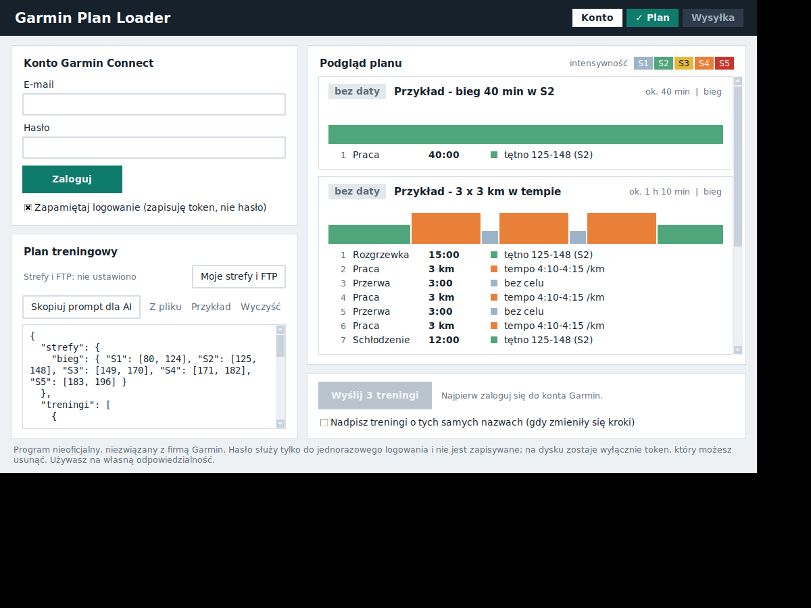

# Garmin Plan Loader

Proste okienko do wgrywania **planu treningowego od trenera** do **Garmin Connect** – razem z datami w kalendarzu, tak żeby treningi same pojawiły się na zegarku po synchronizacji.

Bez terminala, bez instalowania Pythona. Pobierasz, uruchamiasz, logujesz się, wklejasz plan, wysyłasz.

> ⚠️ **Program nieoficjalny.** Nie jest związany z firmą Garmin ani przez nią wspierany. Korzysta z nieoficjalnej biblioteki [python-garminconnect](https://github.com/cyberjunky/python-garminconnect), która może przestać działać po zmianach po stronie Garmina. Używasz na własną odpowiedzialność, zgodnie z regulaminem Garmin Connect.



## Jak używać

1. **Pobierz** program z zakładki [Releases](../../releases) (Windows: `GarminPlanLoader-Windows.zip`, Mac: wersja Apple Silicon lub Intel) i go rozpakuj.
2. **Zaloguj się** e-mailem i hasłem do Garmin Connect (jeśli masz włączone MFA – wpisz kod z e-maila/SMS/aplikacji, gdy program o niego poprosi).
3. **Ustaw raz swoje strefy** (przycisk „Moje strefy i FTP”): strefy tętna dla biegu, roweru i pływania, FTP oraz strefy mocy roweru w watach (można je policzyć z FTP jednym przyciskiem). Zostają zapisane na Twoim komputerze i program używa ich do każdego kolejnego planu.
4. **Skopiuj prompt** przyciskiem „Skopiuj prompt dla AI”, wklej go do swojego asystenta AI (ChatGPT, Claude, Gemini…) razem z planem od trenera. Prompt już zna Twoje strefy, więc AI o nie nie pyta. AI zwróci plan w formacie JSON.
5. **Wklej JSON** do okna programu. Podgląd pojawia się sam: każdy trening jako karta z wykresem intensywności i listą kroków – **sprawdź go, zanim wyślesz**.
6. **Wyślij.** Treningi trafią do Garmin Connect (Trening → Treningi) i do kalendarza. Zsynchronizuj zegarek.

Przycisk „Przykład” wstawia gotowy przykładowy plan, żeby zobaczyć, jak to działa.

Kolejny tydzień? Wklej nowy plan i wyślij – treningi o tej samej nazwie nie są dublowane, a jeśli zmieniła się data, wpis w kalendarzu jest przestawiany. Zaznacz „Nadpisz”, gdy zmieniły się same kroki.

## Format planu

```json
{
  "strefy": {
    "bieg": { "S1": [80, 124], "S2": [125, 148], "S3": [149, 170], "S4": [171, 182], "S5": [183, 196] }
  },
  "treningi": [
    {
      "nazwa": "3 x 3 km @ 4:10-4:15",
      "sport": "bieg",
      "data": "2026-10-06",
      "kroki": [
        { "typ": "rozgrzewka", "czas": "15:00", "cel": "S2" },
        { "powtorz": 3, "kroki": [
            { "typ": "interwal", "dystans": "3 km", "cel": "4:10-4:15" },
            { "typ": "przerwa",  "czas": "3:00",    "cel": "S1" }
        ]},
        { "typ": "schlodzenie", "czas": "10:00", "cel": "S1" }
      ]
    },
    { "data": "2026-10-07", "wolne": true }
  ]
}
```

- **Cel kroku:** strefa (`S1`–`S5`, wg Twojej tabeli), zakres tętna (`HR 150-160`), tempo (`4:10-4:15`), dla roweru moc (`200-220W`) albo brak celu.
- Krok ma **czas** albo **dystans** albo `"przycisk": true` (trwa do naciśnięcia przycisku okrążenia), nigdy kilka naraz.
- Tempo: min/km dla biegu, marszu i turystyki (`4:10-4:15`), min/100 m dla pływania (`1:50-2:00`). Kadencja: `90-100rpm`.
- **Rower, moc:** `"cel"` może być w watach (`200-220W`), w procentach FTP (`90-95% FTP`, program przeliczy na waty z Twojego FTP; pojedyncza wartość, np. `95% FTP`, daje pasmo +/-2 punkty procentowe) albo strefą mocy `P1`-`P5` z Twojej tabeli. `S1`-`S5` to zawsze strefy tętna. FTP można też podać w samym planie (`"ftp": 220`).

## Rodzaje treningów

`"sport"` może mieć wartość: `bieg`, `rower`, `plywanie`, `silowy`, `cardio`, `joga`, `pilates`, `hiit`, `mobilnosc`, `marsz`, `turystyka`, `inny` (polskie i angielskie nazwy są rozpoznawane). Wielosportu (kilka dyscyplin w jednym treningu) program nie obsługuje - rozbij go na osobne treningi. Sporty bez własnej tabeli stref (siła, cardio, marsz itd.) używają tętna z tabeli biegowej; rower i pływanie mają własne.

### Trening siłowy

Kroki to ćwiczenia z katalogu Garmin Connect (ok. 1500 pozycji):

```json
{
  "nazwa": "Siła A",
  "sport": "silowy",
  "kroki": [
    { "typ": "rozgrzewka", "czas": "8:00" },
    { "cwiczenie": "Barbell Back Squat", "serie": 4, "powtorzenia": 6, "ciezar": "70kg", "przerwa": "2:00" },
    { "cwiczenie": "Plank", "serie": 3, "czas": "0:45", "przerwa": "1:00" },
    { "powtorz": 3, "kroki": [
      { "cwiczenie": "Pull-up", "powtorzenia": 6 },
      { "cwiczenie": "Dumbbell Row", "powtorzenia": 10, "ciezar": 20 }
    ] }
  ]
}
```

- Nazwę ćwiczenia podaj po angielsku jak w Garmin Connect (np. `Romanian Deadlift`); program rozpoznaje też popularne polskie nazwy (`przysiad ze sztangą`, `martwy ciąg`, `podciąganie`).
- Gdy ćwiczenia nie ma w katalogu, dodaj `"kategoria"` (np. `"kategoria": "LEG_CURL"`) - Garmin pokaże wtedy samą kategorię, a nazwa z planu trafi do opisu w podglądzie.
- `powtorz` robi serie łączone (obwód): kolejne ćwiczenia w rundach.
- `ciezar` jest w kilogramach i opcjonalny, `przerwa` to odpoczynek po każdej serii (także po ostatniej, jak w edytorze Garmina).

> **Uwaga:** format ćwiczeń siłowych jest zgodny z tym, co buduje biblioteka python-garminconnect. Pozostałe typy (pływanie, joga, HIIT itd.) używają zwykłych kroków i nie zostały jeszcze sprawdzone na prawdziwym koncie Garmin - jeśli Garmin coś odrzuci, program pokaże jego komunikat przy danym treningu.

- Sekcja `strefy` w planie jest **opcjonalna**: bez niej program użyje stref zapisanych w „Moje strefy”. Jeśli plan ją zawiera, ma pierwszeństwo.
- Prawidłowy prompt do swojego AI dostajesz przyciskiem w programie – nie musisz pisać formatu ręcznie.

## Prywatność i bezpieczeństwo

- Hasło służy tylko do jednorazowego zalogowania, **nie jest zapisywane** i nie jest nigdzie wysyłane poza serwery Garmina.
- Na dysku zostaje **token logowania** w folderze `.garmin-plan-loader` w katalogu domowym (możesz zdjąć ptaszek „Zapamiętaj” albo użyć „Wyloguj i usuń token”) oraz Twoje strefy, FTP i strefy mocy w pliku `.garmin-plan-loader-ustawienia.json`. Wylogowanie nie kasuje stref; usuniesz je w oknie „Moje strefy”.
- Program nie ma żadnej telemetrii ani własnego serwera. Kod jest w tym repozytorium – możesz go przeczytać.

## Ostrzeżenia przy pierwszym uruchomieniu

Program nie jest podpisany certyfikatem (to kosztuje), więc system może go ostrzegać:

- **Windows (SmartScreen):** „Windows ochronił ten komputer” → **Więcej informacji → Uruchom mimo to**. Niektóre antywirusy mogą fałszywie alarmować przy programach spakowanych PyInstallerem; możesz uruchomić program ze źródeł (niżej).
- **macOS (Gatekeeper):** kliknij program **prawym przyciskiem → Otwórz → Otwórz**. Jeśli to nie pomaga: Ustawienia systemowe → Prywatność i ochrona → „Otwórz mimo to”.

## Uruchomienie ze źródeł

Wymaga Pythona 3.10+ z tkinter.

```bash
pip install -r requirements.txt
python app.py
```

Testy: `pip install pytest && python -m pytest tests`

## Budowanie

Paczki buduje GitHub Actions (`.github/workflows/build.yml`) dla Windows i macOS. Wydanie powstaje po wypchnięciu tagu `vX.Y.Z`.

## Licencja

MIT – zobacz [LICENSE](LICENSE).
